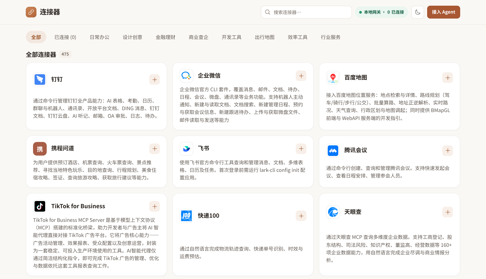
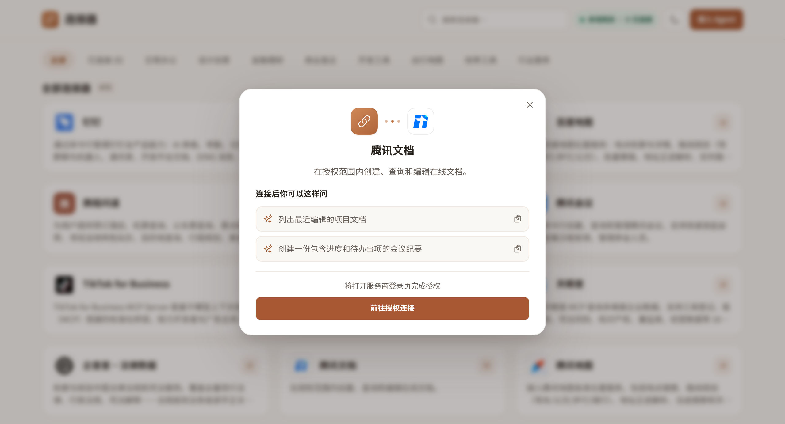
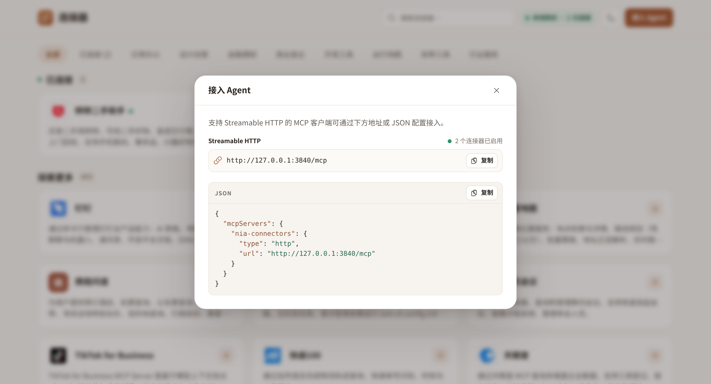

# Nia Connectors

[简体中文](./README_CN.md) · [Connector Registry](https://github.com/nia-teams/nia-connector-registry)

Give **Claude Code, Codex, Cursor, Antigravity**, and other global AI tools access to hundreds of services (primarily Chinese services).

1. Open the local page, find the services you use, and sign in with one click (or enter a key once).
2. Click **接入 Agent** (Connect Agent) and paste the config into your AI client.
3. Your AI can then call the services you connected, with credentials kept encrypted on your own machine.



> Note: The web dashboard UI is currently in Chinese (English labels for key buttons are noted below).
> Using an AI coding assistant to set this up? Load [`skills/nia-connectors/SKILL.md`](./skills/nia-connectors/SKILL.md).

## Quick start

Clone the repository and run from its root with Node.js 20.19 or later:

```sh
npm ci
npm run build
npm start
```

Open [http://127.0.0.1:3840](http://127.0.0.1:3840) in your browser.

## 1. Connect your services

Search for any service and follow its setup prompt:
- **Browser sign-in (OAuth):** Click **前往授权连接** (Authorize) and approve access with the provider—no need to register your own OAuth app. Test the connection and choose which tools to expose.
- **API key:** Enter your key once; it is encrypted and stored locally.
- **CLI tools:** The dashboard checks whether the vendor CLI is installed locally and shows its install and sign-in commands (run in your local shell rather than through `/mcp`).



## 2. Connect your AI

Click **接入 Agent** (Connect Agent) and copy the URL (`http://127.0.0.1:3840/mcp` by default) or the JSON snippet into Claude Code, Codex, Cursor, Antigravity, or any client that supports MCP.



Every enabled service is exposed behind that single address over Streamable HTTP MCP under `<connectorId>__<toolName>` (tools only; prompts and resources are not aggregated). Refresh the tool list in your AI client after adding services or changing tool filters.

## Auth and data boundary

- **Your credentials stay on your machine:** Tokens and API keys are encrypted locally with AES-256-GCM and are never stored in a cloud database.
- **Most services sign in directly from your machine:** Your computer talks straight to the provider to authorize, exchange, and refresh tokens (standard MCP OAuth 2.1 with dynamic registration and PKCE S256).
- **Some services relay sign-in through a stateless broker:** For providers that require a pre-registered app, the sign-in callback, token exchange, and refresh pass through `nia-teams.com` because the app's `client_secret` cannot live in the client. The broker **does not store your tokens**, and once signed in, all tool calls go directly from your machine to the provider.
- **Disconnecting:** Clicking Disconnect clears the local sign-in credentials. To revoke the grant itself, remove access in the provider's account settings.

## Configuration

| Variable | Purpose |
| --- | --- |
| `REGISTRY_URL` | HTTP(S) URL, absolute path, or `file://` URL of `catalog.json`. Defaults to the public connector catalog (`https://nia-teams.github.io/nia-connector-registry/catalog.json`). |
| `HOST` | Listen address. Defaults to `127.0.0.1`. |
| `PORT` | Listen port. Defaults to `3840`. |
| `PUBLIC_BASE_URL` | HTTP(S) origin used for generated MCP URLs, OAuth callbacks, and Host/Origin checks. Defaults to loopback; preserve this Host at any reverse proxy. |
| `NIA_CONNECTORS_HOME` | State directory. Defaults to `~/.nia-connectors`; use a separate directory per instance. |
| `NIA_OAUTH_BROKER_URL` | Trusted OAuth broker base URL. Defaults to `https://nia-teams.com/api/connectors/oauth`. |
| `ALLOW_STDIO` | Set to `1` to allow running local stdio MCP subprocesses defined by the registry. Disabled by default. |

## Self-hosting

- The hub is single-user and does not authenticate API or `/mcp` requests. Keep it on loopback, a private network, or behind an authenticated TLS proxy.
- For remote OAuth, set `PUBLIC_BASE_URL` to a browser-reachable HTTPS origin, allow top-level GET requests to `/api/oauth/callback`, and avoid logging query strings at the reverse proxy.
- Use a trusted registry and least-privilege credentials. With `ALLOW_STDIO=1`, registry-defined local MCP programs run as the server's OS user.
- Protect the encrypted state file and `.master.key` together. Disabling an API-key connector keeps the local key; revoke the key with the provider to remove access.

## Development

```sh
npm run dev
npm run build
npm test
```

Vite serves the dashboard on `127.0.0.1:5173` and proxies API/MCP requests to the Node server. Production serves the dashboard, `/api`, and `/mcp` on one port.

For an offline demo, run `REGISTRY_URL=examples/catalog.json ALLOW_STDIO=1 npm start` after building. The hub loads the bundled sample catalog; enable **本地演示工具** (Local Demo Tools) to try the echo tool.

[MIT license](./LICENSE) · [Nia Teams](https://nia-teams.com)
