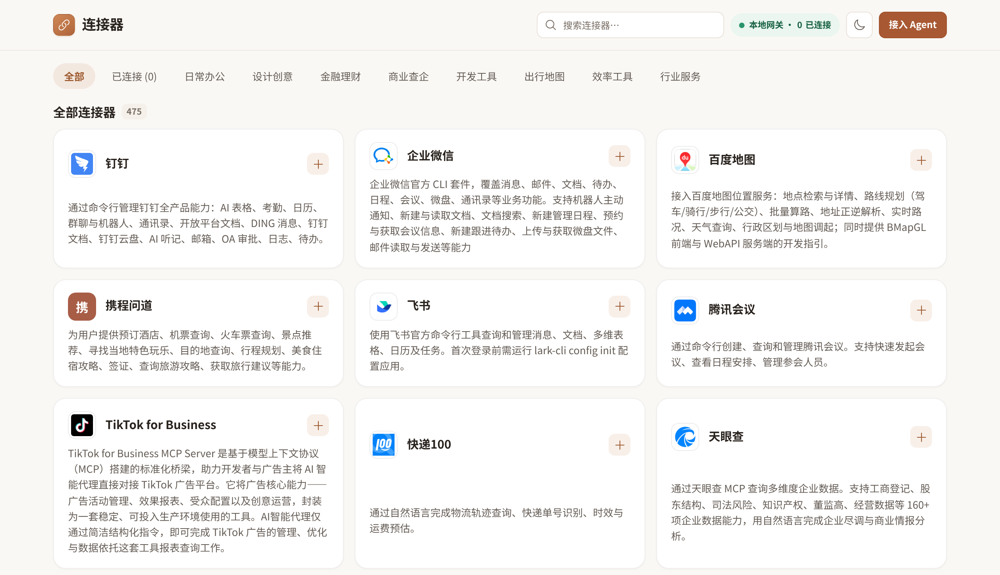
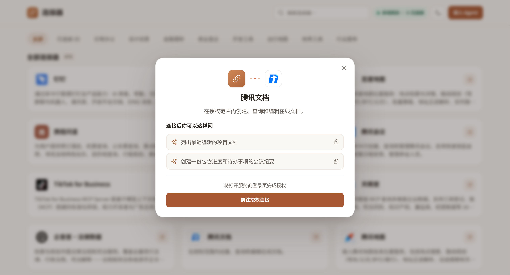
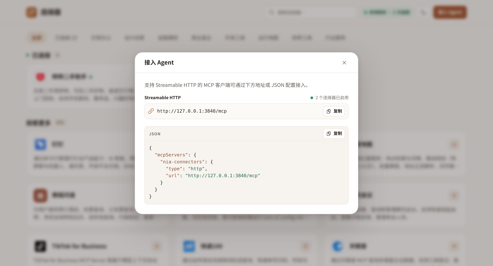

# Nia Connectors

[English](./README.md) · [连接器目录](https://github.com/nia-teams/nia-connector-registry)

让 **Claude Code、Codex、Cursor、Antigravity** 等海外 AI，直接用上数百个常用服务（以国内服务为主）。

1. 在本机打开网页，搜到要用的服务，点一下登录（或填一次密钥）；
2. 点右上角「接入 Agent」，把生成的配置贴进你的 AI；
3. 之后就能让 AI 直接调用你连上的服务，账号凭据只加密留在你自己电脑上。



> 如果你在用 AI 编程助手帮你接入，直接让它加载 [`skills/nia-connectors/SKILL.md`](./skills/nia-connectors/SKILL.md)。

## 快速开始

克隆仓库，使用 Node.js 20.19 或更新版本，在仓库根目录运行：

```sh
npm ci
npm run build
npm start
```

浏览器打开 [http://127.0.0.1:3840](http://127.0.0.1:3840)。

## 1. 连接你要用的服务

在页面里搜到想用的服务，按提示连上：
- **浏览器登录（OAuth）**：点「前往授权连接」，在服务商页面登录授权即可启用，不用自己去开放平台建应用。连完可以直接点测试，还能勾选只把哪些工具开放给 AI。
- **API Key**：填一次 Key 即可启用，加密保存在本机。
- **命令行工具（CLI）**：页面会检测本机是否已装好对应 CLI，并给出安装与登录命令（这类走本机命令行，不经由 `/mcp`）。



## 2. 接入你的 AI

点右上角「接入 Agent」，复制里面的地址（默认 `http://127.0.0.1:3840/mcp`）或 JSON 配置，贴进 Claude Code、Codex、Cursor、Antigravity 或其他支持 MCP 的客户端即可。



你连上的所有在线服务都会汇总在这一个地址里（底层走标准 Streamable HTTP MCP，工具名格式为 `<连接器 ID>__<工具名>`）。增删服务或调整开放的功能后，在 AI 客户端里刷新一次列表即可生效。

## 授权与数据安全

- **账号凭据只留在你自己的电脑上**：所有令牌与密钥都在本机使用 AES-256-GCM 加密保存，不上传到任何云端数据库。
- **大多数服务由本机直连登录**：本机直接向服务商发起授权并换取、刷新令牌（标准 MCP OAuth 2.1，支持动态注册与 S256 PKCE）。
- **部分服务由无状态代理转发登录**：对于需要提前向服务商注册应用的服务，登录回调、换取和刷新令牌会经过 `nia-teams.com` 转发一下（因为应用密钥不能放进客户端），但代理**不存储你的令牌**；登录完成后，AI 每次调用服务仍然由你的电脑直连服务商。
- **断开连接**：点击「断开连接」会清除本机保存的登录凭据；如需彻底撤销授权，请前往对应服务商的账号设置页操作。

## 配置

| 环境变量 | 用途 |
| --- | --- |
| `REGISTRY_URL` | `catalog.json` 的 HTTP(S) 地址、绝对路径或 `file://` 地址。默认加载公开的连接器目录（`https://nia-teams.github.io/nia-connector-registry/catalog.json`）。 |
| `HOST` | 监听地址，默认为 `127.0.0.1`。 |
| `PORT` | 监听端口，默认为 `3840`。 |
| `PUBLIC_BASE_URL` | 用于生成 MCP 地址和 OAuth 回调、验证 Host/Origin 的 HTTP(S) 源，默认为回环地址。反向代理需保留该 Host。 |
| `NIA_CONNECTORS_HOME` | 状态目录，默认为 `~/.nia-connectors`。多实例需使用独立目录。 |
| `NIA_OAUTH_BROKER_URL` | 可信 OAuth 代理的基础地址，默认为 `https://nia-teams.com/api/connectors/oauth`。 |
| `ALLOW_STDIO` | 设为 `1` 允许运行目录中定义的本地 stdio MCP 子进程，默认关闭。 |

## 自托管

- 服务面向单人使用，不校验 API 或 `/mcp` 请求身份。请仅绑定回环地址、放进内网，或置于带鉴权的 TLS 反向代理之后。
- 远程部署使用 OAuth 时，将 `PUBLIC_BASE_URL` 设为浏览器可访问的 HTTPS 源，放行对 `/api/oauth/callback` 的顶层 GET 请求，且反向代理日志不要记录 query string。
- 仅加载可信目录并使用最小权限凭据；开启 `ALLOW_STDIO=1` 后，目录中的本地 MCP 程序会以当前系统用户身份运行。
- 妥善保管加密状态文件与同目录 `.master.key`。停用 API Key 连接器会保留本地密钥；如需彻底失效请在服务商处吊销。

## 开发

```sh
npm run dev
npm run build
npm test
```

开发模式由 Vite 在 `127.0.0.1:5173` 提供界面并转发请求至 Node 服务；生产模式在同一端口提供界面、`/api` 与 `/mcp`。

离线体验时，构建后运行 `REGISTRY_URL=examples/catalog.json ALLOW_STDIO=1 npm start` 即可加载内置示例目录，启用「本地演示工具」可试用回显工具。

[MIT 许可证](./LICENSE) · [Nia Teams](https://nia-teams.com)
